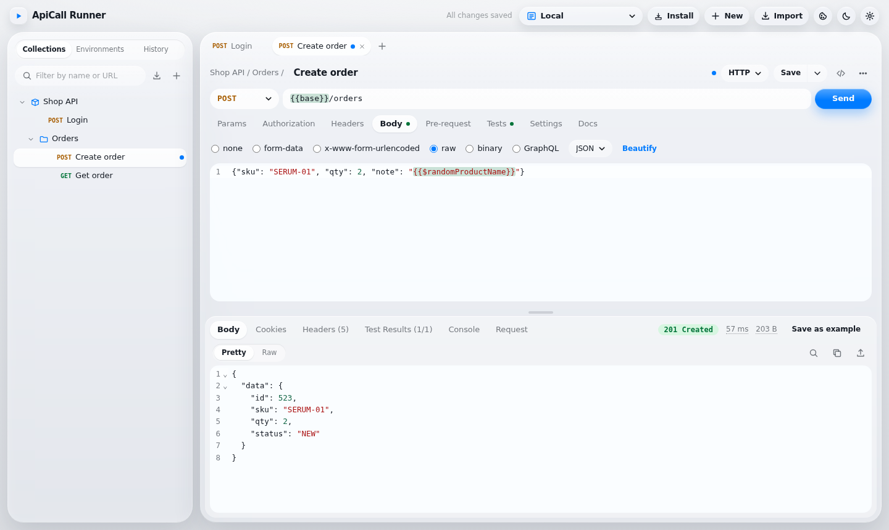
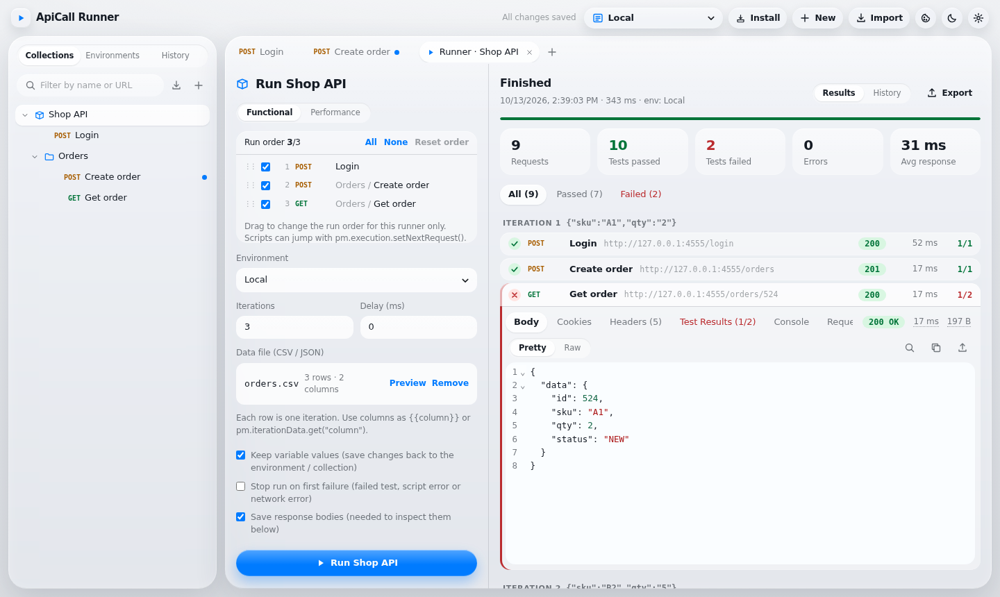
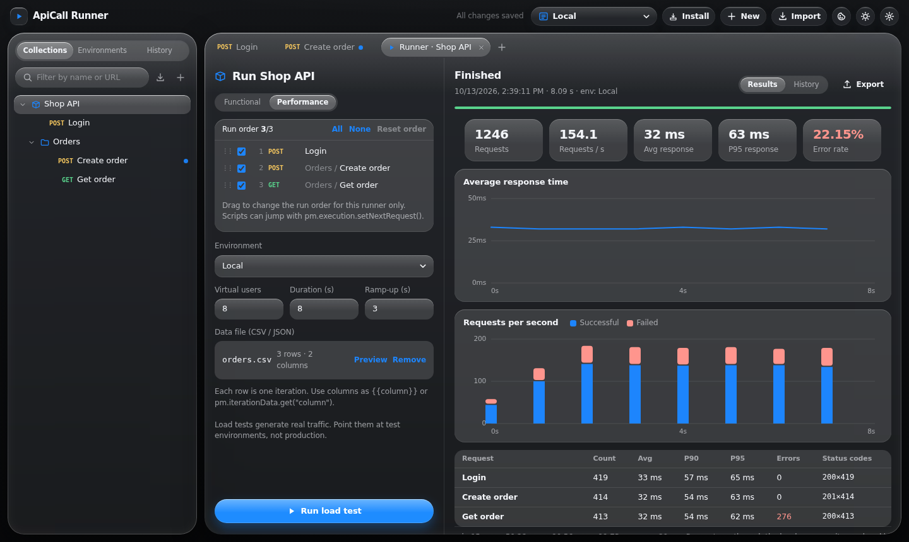
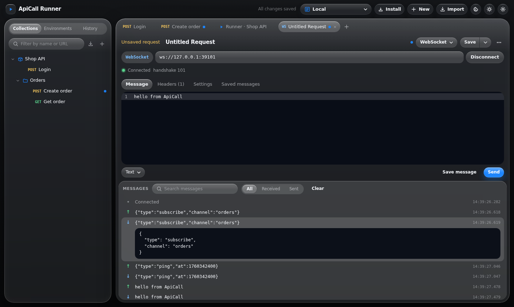
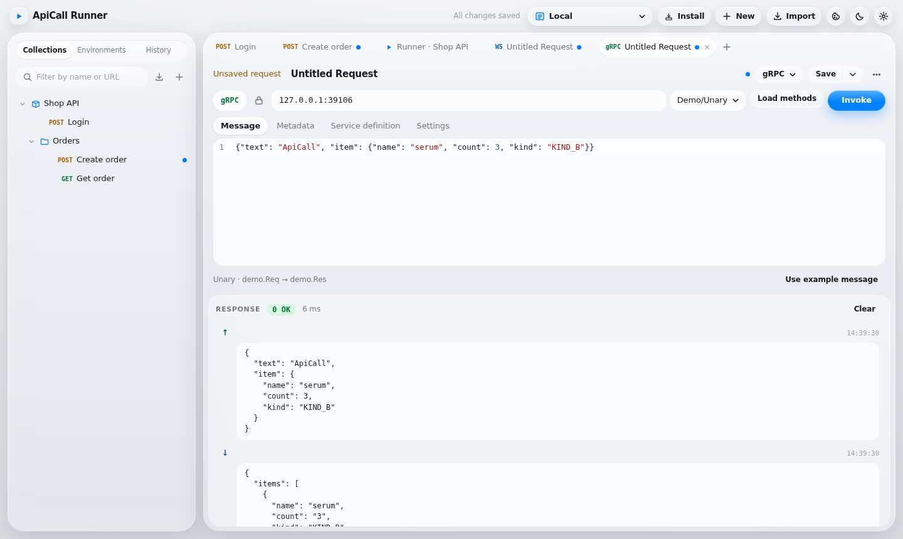

<div align="center">

# ApiCall Runner

**A self-hosted, Postman-compatible API client that runs in your browser.**
Requests, collection runner, load testing, WebSocket, Socket.IO, MQTT and gRPC, plus a Newman-style CLI for CI.
One Docker command, no account, no cloud, no telemetry.

[](LICENSE)
[](https://github.com/nhankhtn/apicall/pkgs/container/apicall)
[](package.json)
[](#postman-compatibility)

[Quick start](#quick-start) · [Features](#features) · [Postman compatibility](#postman-compatibility) · [CLI](#cli-for-ci) · [Deploy](#deploy) · [Development](#development)



</div>

---

## Why

- **Your Postman collections, unchanged.** Import v2.0/v2.1 collections and environments; `pm.*` scripts, tests, auth and variables keep working.
- **Nothing leaves your machine.** Collections live in your browser (IndexedDB). The small Node server only relays requests, so there are no CORS errors and internal APIs are reachable.
- **More than HTTP.** WebSocket, Socket.IO, MQTT and gRPC (reflection or `.proto` files, all four call types) sit next to your REST requests.
- **Built for teams and CI.** A Newman-style CLI with JUnit reports, a load-test mode, a Docker image, and optional login when you share it.

## Quick start

```bash
docker run -d --name apicall \
  -p 127.0.0.1:3939:3939 \
  --add-host=host.docker.internal:host-gateway \
  -v apicall-data:/data \
  ghcr.io/nhankhtn/apicall:latest
```

Open **http://localhost:3939**. Chrome and Edge show an **Install** button, so ApiCall can run in its own window like a desktop app.

> An API on the same machine is `host.docker.internal`, not `localhost`: inside the container, `localhost` is the container itself.
> The port is published on loopback only. To share the app with others, see [Deploy](#deploy) and turn on login.

From source (Node 20.18+):

```bash
git clone https://github.com/nhankhtn/apicall.git && cd apicall
npm install
npm run dev          # API on :3939 + Vite on :5173 with hot reload → http://localhost:5173
# or
make start           # production build served on http://localhost:3939
```

Then import a Postman collection (**Import** → file or paste), pick an environment and press **Send**. You can also paste a `curl` command straight into the URL bar; the bash and Windows `cmd` formats from Chrome DevTools both work.

## Features

### Requests

- Tabs like Postman (preview tabs, drag to reorder, unsaved dot), **Ctrl+S** save, Save As, revert, and a history of everything you sent.
- `{{variables}}` highlighted green or red, autocomplete after `{{`, hover cards showing value and scope. Works in the URL, headers, params, auth and code editors.
- Query params you can toggle, path variables (`/orders/:id`), headers with descriptions, bulk edit.
- Bodies: raw (JSON, XML, text…), form-data with files, x-www-form-urlencoded, binary, GraphQL.
- Auth: Bearer, Basic, API Key, JWT (HS/RS/PS/ES), Digest, OAuth 2.0 (client credentials, password, refresh token, authorization code + PKCE), AWS Signature v4, Hawk, NTLM v2, inherited from folders and collections.
- Response: pretty, raw, HTML/image/PDF preview, `pm.visualizer`, search (Ctrl+F), cookies, headers, test results, console, the exact request sent; TTFB/download timing; save as example.
- Per-request settings: SSL verification, redirects, cookie jar, timeout. Global proxy and client certificates (mTLS).
- Code snippets in 18 languages and Copy as cURL.

### Collection runner



Iterations, delay, CSV/JSON data files, `pm.execution.setNextRequest`, stop on first failure, reorder or skip requests for a run, keep or discard variable changes, filter passed/failed, inspect every response, export a JSON report, and browse past runs.

### Load testing



Virtual users, duration and ramp-up. Every request still runs its scripts and tests. Charts for response time and throughput, plus p50/p90/p95/p99 and error rate per request.

### WebSocket, Socket.IO, MQTT, gRPC



- **WebSocket:** handshake headers, subprotocols, text/JSON/binary messages, saved messages, searchable log.
- **Socket.IO v3/v4:** path, handshake auth, listen to events (or `*`), emit with ack.
- **MQTT 3.1.1/5:** `mqtt://`, `mqtts://`, `ws://`, `wss://`, subscriptions with QoS, publish with retain.
- **gRPC:** server reflection or imported `.proto` files, generated example messages, metadata, deadlines, TLS; unary, server, client and bidirectional streaming.

Switch any request between HTTP, WebSocket, Socket.IO, MQTT and gRPC from the type menu next to its name.



### Scripts (`pm.*`)

Pre-request and test scripts at collection, folder and request level, run in a Web Worker so imported scripts cannot touch the page:

`pm.test`, `pm.expect` (Chai), `pm.response` (`json()`, `to.have.status`, `to.have.jsonSchema`, `to.have.responseTime.below`, …), `pm.request` (URL, query, path variables, headers, body), `pm.environment`, `pm.collectionVariables`, `pm.globals`, `pm.variables`, `pm.iterationData`, `pm.cookies` and `pm.cookies.jar()`, `pm.vault`, `pm.visualizer`, `pm.sendRequest`, `pm.execution.setNextRequest/skipRequest`, `pm.info`, legacy `postman.*` and `tests[]`, plus `CryptoJS`, lodash, moment, `xml2Json`, cheerio, tv4/ajv, `require()` and top-level `await`.

### Variables and data

Environments, collection variables and globals with **initial and current values** and **secret** types (masked), Persist all / Reset all, a vault for secrets that never leave the browser (`{{vault:key}}`), about 60 dynamic variables (`{{$guid}}`, `{{$timestamp}}`, `{{$randomEmail}}`…), and an automatic cookie jar with a cookie manager.

## Postman compatibility

| | |
|---|---|
| Import | Collections v2.0/v2.1 (folders, scripts, auth, variables, path variables, disabled params, examples, files, GraphQL, protocol settings), environments, `curl` (bash and Windows cmd) |
| Export | Collections v2.1 and environments, ready to open in Postman or run with Newman |
| Scripts | The `pm.*` API above; collection → folder → request order for both pre-request scripts and tests |
| Not included | Cloud features (sync, team workspaces, mock servers, monitors, published docs), Kerberos, Akamai EdgeGrid |

WebSocket, Socket.IO, MQTT and gRPC requests are kept in workspace backups. Postman's v2.1 format has no place for them, so collection exports contain HTTP requests only.

## Your data

Everything lives in **your browser's IndexedDB**: collections, environments, history, run results, attachments and vault. Each browser profile has its own workspace, so people sharing one server never overwrite each other, and the app asks the browser to keep the data from being evicted.

- Data belongs to the address you open: `localhost:3939` and `127.0.0.1:3939` are separate workspaces.
- Back up with **Settings → Data → Export backup** (attachments included) and restore with **Import**.
- Clearing site data in the browser deletes the workspace, so keep backups.

## CLI for CI

Export a collection and an environment from the app, then:

```bash
npx apicall run ./Shop.postman_collection.json -e ./Local.postman_environment.json \
  -d orders.csv --reporters cli,junit --reporter-junit-export out/junit.xml
```

Options: `-f` folder, `-n` iterations, `-d` data file, `--env-var k=v`, `--delay-request`, `--timeout-request`, `-k` (skip TLS verification), `--bail`, `--export-environment`. The exit code is 1 when a request or assertion fails. See `npx apicall --help`.

## Deploy

| Variable | Default | |
|---|---|---|
| `PORT` | `3939` | Server port |
| `HOST` | `127.0.0.1` (`0.0.0.0` in Docker) | Listen address |
| `APICALL_USER`, `APICALL_PASSWORD` | — | HTTP Basic login for the UI and API. **Set these before others can reach the server**: the proxy sends requests anywhere |
| `APICALL_ALLOWED_HOSTS` | — | Without login only `localhost`/`127.0.0.1` are served (DNS-rebinding protection). Add host names or IPs, comma separated |

**Docker:** `make docker-run APP_USER=admin APP_PASS=…` builds and runs the image (non-root, healthcheck on `/api/health`). `make publish` pushes to `ghcr.io/<owner>/<repo>` taken from your `origin` remote; `make push REGISTRY=…` pushes anywhere.

**Vercel:** `make vercel-env APP_USER=… APP_PASS=…`, then `make vercel-prod`. `vercel.json`, `api/index.js` and `middleware.js` are included. On Vercel the app has the HTTP proxy only (no WebSocket, Socket.IO, MQTT or gRPC calls, since functions cannot keep connections open), requests leave from Vercel's cloud so internal/VPN APIs are unreachable, and bodies are limited to about 4 MB.

## Keyboard shortcuts

| Shortcut | Action |
|---|---|
| `Ctrl` + `Enter` | Send |
| `Ctrl` + `S` / `Ctrl` + `Shift` + `S` | Save / Save As |
| `Alt` + `N` / `Alt` + `W` | New request / close tab |
| `Ctrl` + `F` | Search in an editor or the response |
| `F2`, `Delete` | Rename / delete in the sidebar |
| `{{` | Variable autocomplete |

## Development

```bash
make dev       # server (node --watch) + Vite
make build     # production build into dist/
make help      # every target: docker, publish, vercel, cli…
```

```
Browser (React + Vite)                                server/index.mjs  (api/index.js on Vercel)
 ├─ IndexedDB: workspace, history, runs, files         ├─ POST /api/proxy           → server/proxy.mjs (undici)
 ├─ engine.worker.js: scripts + HTTP engine            ├─ WS   /api/realtime        → server/realtime.mjs
 └─ realtime.js: one WebSocket for every session       └─ POST /api/grpc/describe   → server/grpc.mjs
bin/cli.mjs: the same engine in Node, calling server/proxy.mjs directly
```

| Path | |
|---|---|
| `src/lib/engine.js` | Request execution (scripts, cookies, Digest retry, OAuth 2.0), collection runs, load tests |
| `src/lib/build.js` | Turns an edited request into the exact request sent (variables, auth, body, cookies) |
| `src/lib/sandbox.js` | The `pm.*` API |
| `src/lib/authsign.js`, `server/ntlm.mjs` | AWS SigV4, Digest, JWT, Hawk; NTLM handshake |
| `src/lib/model.js` | Data model, Postman import/export, `curl` parsing |
| `src/lib/codegen.js` | Code snippets for 18 languages |
| `server/auth.mjs` | Login, allowed hosts, same-origin checks |

## Security

- Scripts run in a Web Worker: they cannot read the page, its storage or the vault, but they can make network requests through `pm.sendRequest`. Import collections you trust.
- Without login the server answers only on loopback host names and refuses cross-origin calls, so a web page you visit cannot use it to reach your network.
- Load tests send real traffic. Point them at test environments.

## License

[MIT](LICENSE) © Ngô Nguyễn Duy Nhân
